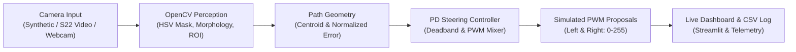

# Camera-Based Path Following & Live Dashboard Prototype

**Project:** Raspberry Pi Autonomous Vehicle — Software Prototype for Review-I  
**Platform:** Windows 64-bit / CPU-only laptop execution (Python 3.11 / 3.12 compatible)  

> [!IMPORTANT]
> **SIMULATION / LAPTOP PROTOTYPE — NO HARDWARE CONTROL**  
> All motor PWM and steering outputs produced by this application are software-in-the-loop proposals for Review-I verification. No physical Raspberry Pi GPIO, motor drivers (e.g., L298N), Arduino firmware, or physical vehicles are commanded in this prototype.

---

## 1. Overview & Architecture

This project provides a fully functional, explainable, and testable computer-vision prototype that demonstrates how a forward-facing camera enables autonomous path tracking. The pipeline runs completely on a local laptop without requiring GPUs, paid cloud APIs, or complex robotics middlewares.



### Pipeline Details:
1. **Perception:** Captures frame $\rightarrow$ converts BGR to HSV $\rightarrow$ thresholds target color (default yellow tape) $\rightarrow$ applies morphological open/close filtering $\rightarrow$ crops Region of Interest (ROI) in lower road view $\rightarrow$ rejects small noise blobs ($< 400\text{ px}$) $\rightarrow$ computes path centroid $(c_x, c_y)$ using spatial moments.
2. **Normalized Lateral Error:**
   $$\text{error} = \frac{c_x - \frac{W}{2}}{\frac{W}{2}} \in [-1.0, +1.0]$$
   - Negative error: Path is to the left of optical center.
   - Positive error: Path is to the right of optical center.
   - Error within deadband ($\pm 0.05$): Treated as straight.
3. **PD Steering Controller:**
   $$u = K_p \cdot \text{error} + K_d \cdot \frac{de}{dt}$$
   Differential drive simulated PWM proposals:
   $$\text{PWM}_{\text{left}} = \text{clip}(\text{base\_speed} + u, 0, 255)$$
   $$\text{PWM}_{\text{right}} = \text{clip}(\text{base\_speed} - u, 0, 255)$$
4. **Safety Failsafe:** If the path disappears or is occluded, the system immediately asserts `PATH_LOST`, issues a `STOP` command, and outputs `0` PWM to both motors.

---

## 2. Quickstart: Installation & Running on Windows

### Prerequisites
- Windows 10 / 11 64-bit
- Python 3.11 or 3.12 installed and accessible in PowerShell

### Setup Virtual Environment
Open PowerShell in the project directory:

```powershell
# 1. Create and activate a clean virtual environment
python -m venv .venv
.\.venv\Scripts\Activate.ps1

# 2. Upgrade pip and install pinned verified dependencies
python -m pip install --upgrade pip
pip install -r requirements.txt
```

### Run Automated Tests
Execute the full test suite with 30 unit, integration, and safety tests:

```powershell
python -m pytest -v
```

### Launch Interactive Streamlit Dashboard
```powershell
streamlit run app.py
```
The dashboard opens automatically in your web browser at `http://localhost:8501`.

---

## 3. Input Modes

### A. Synthetic Demo Mode
- **No camera or video file required.**
- Select from 7 deterministic scenarios: `straight_centered`, `straight_left`, `straight_right`, `curve_left`, `curve_right`, `noisy_centered`, and `missing_path`.
- Or select **Streaming Sequence** for a continuous multi-segment driving sequence that smoothly transitions between straights, curves, and path-loss events.

### B. Recorded Video Input (Samsung Galaxy S22 Workflow)
You can directly record videos of colored tape on paper or the floor using your Samsung Galaxy S22:
1. Record a video on your phone (e.g. 1080p, 30fps).
2. Copy the video to the laptop in `data/input_videos/` or upload it directly through the dashboard's **Upload S22 Recording** widget.
3. In the sidebar, select **Video File**.
4. Adjust the HSV threshold sliders in real-time to match the ambient lighting of the recording.
5. Watch the annotated road view, segmentation mask, and simulated steering decisions update frame-by-frame.
6. Enter a name (e.g. `s22_living_room_light`) and click **Save Calibration Preset** to save the tuned parameters into `configs/`.

To generate a sample synthetic video file for immediate testing:
```powershell
python tools/make_demo_video.py
```

### C. Live Webcam Mode
- Select **Webcam** in the dashboard sidebar.
- Enter device index (0 for built-in laptop camera, 1 for external USB webcam).
- If no webcam is attached or permission is denied, a clear, recoverable warning is displayed without crashing.

---

## 4. Telemetry Logging

Enable the **Log to CSV** toggle in the sidebar to write high-resolution metrics for every processed frame to `results/logs/`:
- `timestamp`: Epoch seconds.
- `iso_time`: Human-readable ISO timestamp.
- `source`: Active frame source identifier.
- `frame_index`: Sequential frame count.
- `path_valid`: Boolean detection flag.
- `path_center_x`: Pixel X coordinate of path centroid.
- `normalized_error`: Lateral displacement in $[-1.0, +1.0]$.
- `state`: Controller state (`STRAIGHT`, `LEFT`, `RIGHT`, `PATH_LOST`, `STOP`).
- `left_pwm`, `right_pwm`: Simulated motor proposals (`0-255`).
- `processing_ms`: Measured execution time in milliseconds.
- `fps`: Measured throughput rate.

To run an automated batch pass over a video clip and generate a complete CSV log:
```powershell
python tools/run_video_pipeline_batch.py
```

---

## 5. Repository Layout

```text
caps/
├── app.py                         # Streamlit interactive dashboard entry point
├── requirements.txt               # Pinned verified dependencies
├── pytest.ini                     # Pytest configuration
├── README.md                      # Project documentation and quickstart
├── configs/
│   └── default.yaml               # Default HSV and PD controller settings
├── pathdemo/
│   ├── __init__.py
│   ├── config.py                  # Dataclass configs, validation, YAML save/load
│   ├── sources.py                 # Synthetic, Video File, and Webcam frame sources
│   ├── synthetic.py               # Deterministic test frame & sequence generators
│   ├── perception.py              # HSV thresholding, morphology, contour analysis
│   ├── controller.py              # Pure Python PD controller with PWM mixing
│   ├── pipeline.py                # End-to-end frame processing and benchmarking
│   └── telemetry.py               # Real-time CSV logging
├── tests/
│   ├── test_config.py             # Config loading and boundary validation tests
│   ├── test_perception.py         # Perception accuracy, noise rejection & scaling tests
│   ├── test_controller.py         # Steering sign conventions, saturation & safety tests
│   ├── test_synthetic.py          # Synthetic generator tests
│   ├── test_sources.py            # Video file, webcam fallback, and stream tests
│   └── test_pipeline.py           # End-to-end pipeline and telemetry tests
├── tools/
│   ├── make_demo_video.py         # Generates sample MP4 video file
│   ├── generate_phase1_figures.py # Produces visual figure artifacts
│   └── run_video_pipeline_batch.py# Runs batch video pipeline and logs CSV
├── data/
│   └── input_videos/              # Storage for user/phone recordings (.mp4, .mov)
├── results/
│   ├── figures/                   # Visual output overlays, masks, and screenshots
│   └── logs/                      # Telemetry CSV log files
└── docs/
    ├── EXPLAINER.md               # Technical defense guide and viva Q&A
    ├── PROGRESS.md                # Phase-by-phase implementation progress log
    ├── KNOWN_ISSUES.md            # Hardware limits and lighting boundaries
    └── VERSIONS.md                # Verified environment and package versions
```

---

## 6. Review-I Verification Summary

- **30 / 30 Automated Acceptance Tests Passing.**
- **Zero Cloud/GPU Dependencies:** Runs on standard laptop CPU.
- **Genuine Output Evidence:** Actual screenshots and telemetry logs stored in `results/figures/` and `results/logs/`.
- **Explainable Classic CV Baseline:** Deterministic and defensible against Viva questioning without black-box neural network claims.
